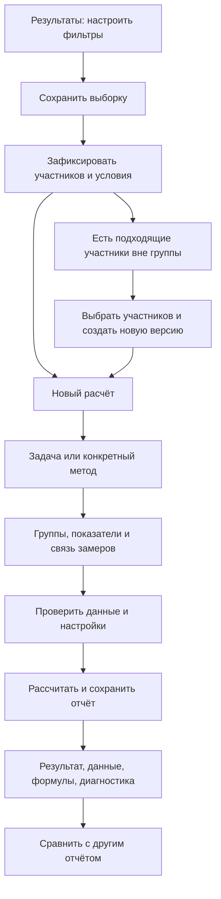

План статистического анализа в mindresearch. Дата: 19.10.2026. Статус: проект для обсуждения, разработка и деплой не начаты.

## 1. Что согласовано

- Работаем внутри одного созданного пользователем опроса. Методики, их шкалы, авторские тесты и вопросы этого опроса могут участвовать в анализе. Объединение разных опросов по разным ссылкам сейчас не входит в разработку.
- Состав сохранённой выборки фиксируется. Подходящих участников вне группы показываем отдельно; пользователь сам выбирает, кого добавить. Добавление и удаление участников создают новую версию группы.
- Нужно и сопоставление сохранённых отчётов рядом, и статистическая проверка различий между эффектами, когда для этого достаточно данных и выполнены условия метода.
- Автоматически доступные данные подставляем сами. Все существенные решения видны и управляемы. Недостающие входные данные можно внести вручную, сохранив их происхождение.
- Сохраняем текущий стиль приложения. Предыдущий отменённый редизайн не возвращаем. Новая функция расширяет результаты опроса, не меняет его конструктор и прохождение.
- Это план всей функции, а не обещание ограничиться несколькими популярными критериями. Полный каталог находится в [methods-catalog.md](methods-catalog.md). Поэтапность определяет порядок реализации, а не исключает сложные методы из объёма.

## 2. Что изучено и что ещё необходимо проверить

Проверены текущий экран результатов, `ResultsSelection`, `selection.ts`, `survey-results.ts`, формат сохранённых результатов методик, Excel-экспорт, модель совместного доступа и существующий механизм фоновых задач качества. В приложении уже есть фильтрация по возрасту/ответам и пересечение условий, но сохраняемой сущности исследовательской выборки и воспроизводимого статистического отчёта пока нет. Таблица `dashboard_views` существует, однако по просмотренным обращениям не является готовым API сохранённых выборок; подменять ей новую сущность без проверки не следует.

Проверены главная и тематические страницы [statpsy.ru](https://statpsy.ru/), включая корреляции, регрессию, факторный и дисперсионный анализ. Просмотрены и распознаны оглавления всех трёх PDF, а также отдельные разделы для уточнения вариантов методов:

| Файл | Издание | Страниц PDF | Что важно для объёма |
| --- | --- | ---: | --- |
| `mathematical_methods_psychological.pdf` | А. Д. Наследов. Математические методы психологического исследования, 2004 | 388 | Частные корреляции, сравнение корреляций, ANOVA/MANOVA, регрессия, факторный, дискриминантный и кластерный анализ, многомерное шкалирование |
| `mat_statistics.pdf` | О. Ю. Ермолаев. Математическая статистика для психологов, 2003 | 335 | Непараметрические методы, частоты, дополнительные коэффициенты связи, критерии Линка—Уоллеса и Немени |
| `Sidorenko_Metody_Matematicheskoy_Obrabotki_V_Psihologii_RuLit_Me.pdf` | Е. В. Сидоренко. Методы математической обработки в психологии, 2003 | 345 | Розенбаум, Джонкира, Пейдж, угловое преобразование Фишера, биномиальный критерий, связанные/независимые планы ANOVA |

Все PDF — сканы без текстового слоя. OCR использован для поиска, но формулы, греческие символы, знаки неравенства и таблицы перед реализацией сверяем с изображением страницы. Нельзя считать распознанный текст математическим эталоном.

Каталог уже покрывает найденные семейства и именованные методы. До программирования каждого семейства нужна последовательная проверка его разделов, формул, ограничений и примеров. Пункты «требует уточнения варианта» являются явными задачами исследования, а не реализованной поддержкой. Издания и сайт не заменяют проверку современного вычислительного алгоритма. В частности, нельзя трактовать Манна—Уитни как универсальный тест равенства средних, а главные компоненты как синоним общего факторного анализа.

## 3. Устройство интерфейса

Внутри результатов опроса добавить три локальных раздела:

`Респонденты | Выборки | Статистический анализ`

Текущие таблица, фильтры и экспорт остаются в «Респондентах». В блоке «Выборка» появляется действие **«Сохранить выборку»**, рядом — **«Открыть сохранённую»**. В «Статистическом анализе» две основные области: история расчётов и кнопка **«Новый расчёт»**. Сравнение открывается из выделенных отчётов.

На настольном экране расчёт занимает отдельную страницу: слева короткий список шагов, в центре настройки, справа сводка выбранных данных и числа пригодных наблюдений. На узких экранах шаги идут последовательно; сводка размещается над действием продолжения. Сложные модели не размещать в маленьком модальном окне. Модальное окно подходит только для быстрого сохранения названия выборки.

Использовать существующие элементы управления, цвета, шрифт, плотность и табличные паттерны. Ошибки показывать у соответствующего параметра. Различать «нельзя рассчитать», «можно, но есть ограничение» и «рекомендован другой вариант». Доступность: управление клавиатурой, понятные подписи, управление фокусом, статус фонового расчёта; цвет никогда не является единственным носителем смысла.

### Схема основного пути

## 4. Сохранённые выборки

### Сохранение

1. Пользователь применяет условия к результатам. Сохранение охватывает всю отфильтрованную выборку, не одну страницу таблицы.
2. Окно показывает число участников, условия и статус прохождений. Источник по умолчанию — текущая выборка; отдельным явным действием можно сохранить отмеченных в таблице участников.
3. Название необязательно: предлагаем «Выборка 1» и короткое описание, например «Возраст 25–40 · завершённые». Имя можно изменить позже.
4. Сервер повторно проверяет доступ, условия и состав; не доверяет присланному клиентом числу участников. Сохраняет условия в структурированном виде и точный состав в одной согласованной операции.
5. Для статистики по умолчанию используются завершённые прохождения. Если нужны незавершённые, пользователь явно включает их; пригодность конкретного показателя всё равно проверяется отдельно.

### Список и состав

Для каждой группы: название, число участников, краткие условия, версия, дата изменения, автор. Действия: открыть состав, переименовать, создать копию, использовать в расчёте, архивировать. Архивирование группы не уничтожает отчёты.

В карточке группы:

- «В группе» — участники сохранённого состава;
- «Подходят под условия, но не добавлены» — кандидаты, независимо от того, когда они прошли опрос;
- «Добавить вручную» — поиск среди доступных участников этого же опроса;
- «Изменились / недоступны» — удалённые прохождения, изменившиеся данные или условия, которые больше нельзя проверить.

Перед добавлением показать список и итоговое число. Можно добавить часть кандидатов, всех или никого. Повторное предложение можно отложить/скрыть; скрытые кандидаты доступны по отдельному фильтру. Если вручную добавлен участник, который не соответствует исходным условиям, это видно как ручное исключение с необязательным комментарием. Участник не исчезает из фиксированной группы только потому, что больше не удовлетворяет условию. Недоступные/удалённые данные нельзя включать в новый расчёт.

Условия хранить через ID вопроса, оператор и исходные коды ответов, а не только отображаемые подписи или список sessionIds. Подписи фиксировать для истории. Иначе нельзя корректно найти новых кандидатов или отличить изменение названия ответа от изменения его смысла. Сортировка и номер страницы не являются условиями отбора.

### Версии

Изменение состава или условий создаёт новую версию: «Выборка 1 · v2, +3 / −1». Переименование можно хранить как метаданные с журналом; сохранённый отчёт всегда содержит использованное на момент запуска название. Старые отчёты привязаны к конкретной версии, а не к текущему состоянию группы. При обновлении группы показываем, какие отчёты рассчитаны по более раннему составу, и предлагаем создать новый расчёт. Автопересчёта и тихой перезаписи нет.

## 5. Новый расчёт: пять шагов

### Шаг 1. Задача

Два равноценных входа:

- «Помочь выбрать»: описать данные; сравнить группы; сравнить замеры; найти связи; сравнить эффекты; построить модель; выделить структуру/кластеры.
- «Я знаю метод»: поиск по русскому названию, фамилии, символу и синонимам из полного каталога.

Помощник задаёт только вопросы, которые меняют применимость: число групп/замеров, одни ли это люди, тип переменных, что проверяется. Предлагает методы с объяснением. Не выбирает окончательно метод только по p проверки нормальности и не утверждает, что независимость наблюдений доказана автоматически.

### Шаг 2. Данные

Выбрать сохранённую группу или несколько групп. Для каждой роли выбрать конкретную переменную:

- готовая шкала/подшкала методики, общий балл, домен или фасета;
- результат авторской методики с формулой;
- числовой ответ авторского теста или анкеты;
- категориальный ответ/признак, возраст;
- вручную введённая колонка или таблица частот.

Показывать полный путь: «Методика → Шкала → Средний балл» и единицы/диапазон. Не смешивать сумму и среднее, одинаковые названия шкал, повторы методики, разные версии формул. Идентификатор: surveyId + sectionId + путь показателя + версия расчёта. Итоговый `code` или название недостаточны. Значения брать из точных сохранённых чисел, не из округлённого текста или Excel-файла. Цвет уровня из выгрузки не является основанием для выбора статистического теста.

Разные шкалы одного человека нельзя считать независимыми участниками. Для связанных методов две/несколько колонок выравниваются по sessionId в пределах одного прохождения. Для повторных прохождений одного человека нужен явный устойчивый идентификатор и подтверждённое сопоставление, даже внутри одного опроса. Имя, возраст, пол и положение строки не являются надёжными ключами. При отсутствии ключа — ручное сопоставление с проверкой неоднозначностей; дубликаты не склеиваем автоматически.

Для независимых групп проверять пересечение состава. Если один участник входит в обе группы, не запускать независимый критерий как будто пересечения нет. Предложить изменить группы или выбрать соответствующий связанный план. Для частично пересекающихся групп требуется отдельная поддержанная модель; простая замена на парный тест некорректна.

### Шаг 3. Параметры

Показывать только параметры выбранной процедуры. Безопасные значения по умолчанию видны: двусторонняя гипотеза, α = 0,05, доверительный уровень 95%, явная политика пропусков. Для односторонней гипотезы показать направление и порядок групп до расчёта. Доверительный уровень и α задаются согласованно; их возможное раздельное изменение фиксируется явно.

Примеры дополнительных входов:

| Метод/ситуация | Что задаёт пользователь |
| --- | --- |
| Одновыборочный t | Проверяемое значение среднего и его источник |
| Биномиальный критерий | Что считается успехом; теоретическая вероятность p0 |
| Хи-квадрат согласия | Теоретические доли/частоты, способ объединения категорий |
| φ* Фишера | Событие или заранее заданный порог для дихотомизации |
| Пейдж / Джонкира | Теоретический порядок условий/групп; не порядок после просмотра результата |
| Корреляция | Пара переменных или матрица, контрольные переменные, политика пропусков |
| ANOVA | Зависимая переменная, факторы, связь измерений, взаимодействия и контрасты |
| Регрессия | Зависимая переменная, предикторы, кодирование категорий, преобразования |
| Нелинейная модель | Модель из проверенного списка, стартовые параметры/ограничения, если необходимы |
| Факторный анализ | Извлечение, число факторов, вращение, оценка факторных значений |
| Кластеризация / MDS | Матрица или показатели, метрика, стандартизация, число кластеров/измерений |

Не позволять подменять уже вычисленное значение критерия или p ручным числом в обычном режиме. Ручные входы — отдельный источник/слой данных со своими автором, датой, единицами, причиной и историей. Нормативные параметры не угадываем из максимумов шкалы или среднего текущей выборки.

### Шаг 4. Проверка перед запуском

Показать сводку: выбранные группы/версии, переменные, план, настройки, число исходных и пригодных наблюдений, исключённые строки с причинами, полный набор запускаемых проверок. Таблица исходных значений доступна до расчёта.

Блокирующие случаи: недостаточно данных для конкретной процедуры, неверная размерность/типы, непарные замеры, дубли ключа, пустая категория, недопустимая вероятность, нулевая вариативность для корреляции, вырожденная матрица, некорректная матрица расстояний. Ограничения с допустимой альтернативой: малые ожидаемые частоты, связанные ранги, нулевые разности, асимметрия, неоднородность дисперсий, нарушения сферичности, мультиколлинеарность. Не каждое нарушение означает запрет; решение определяется методом и показывается пользователю.

Пропуски никогда не превращаются в нули. Для парных тестов исключается целая неполная пара, для повторных измерений — соответствующий полный блок по правилам процедуры. В матрицах корреляций можно выбрать попарное/полное исключение с отдельным N для каждой связи и предупреждением о последствиях для матрицы. Автоматической импутации и автоматического удаления выбросов нет. Любые исключения видны и воспроизводимы.

При нескольких шкалах/парах заранее определить семейство гипотез и поправку: Holm для подтверждающих сравнений, Benjamini—Hochberg как вариант исследовательского анализа; «без поправки» — явный выбор с пояснением. Сохранить и исходные, и скорректированные p. Поправку нельзя определять только по отобранным после расчёта «интересным» результатам.

### Шаг 5. Результат

Сохраняемый отчёт имеет необязательное название и страницы/вкладки:

1. **Результат**: проверенная гипотеза, размеры групп/пар, описательные показатели, статистика, степени свободы, p, поправка, эффект и доверительный интервал там, где поддерживаются. График, соответствующий задаче.
2. **Данные**: точные входы, ID строк, происхождение, сопоставление пар, включённые/исключённые наблюдения и причины.
3. **Как рассчитано**: определения, формулы, подстановка агрегатов, промежуточные таблицы, алгоритм p и ДИ, поправки, ссылки на метод и версию движка.
4. **Проверки и ограничения**: диагностика, предупреждения, выбранные допущения, сведения о сходимости и чувствительности.

Действия: «Повторить с другими настройками», «Пересчитать по новой версии выборки», «Сравнить», «Экспортировать». Изменённые настройки создают новый отчёт, исходный сохраняется.

## 6. Что означает полная прозрачность

На примере U Манна—Уитни пользователь увидит:

- какие участники и значения вошли в группы A и B;
- объединённые значения, средние ранги при совпадениях, суммы рангов R_A и R_B;
- формулы U_A = R_A − n_A(n_A+1)/2 и U_B = n_A n_B − U_A;
- оба U и указание, какой именно выводится как основная статистика;
- выбранный точный, перестановочный или асимптотический алгоритм, поправки на совпадения/непрерывность, направление гипотезы;
- исходный и скорректированный p, эффект с определённым направлением и способ вычисления ДИ.

У численных итерационных моделей вместо иллюзии «ручной формулы в одну строку»: целевая функция/модель, матрица дизайна, критерий оптимизации, стартовые значения, ограничения, число итераций, достигнутая точность, статус сходимости и воспроизводимый код запуска. Для bootstrap/permutation — схема пересэмплирования, seed, число повторов, правило остановки и оценка ошибки Монте-Карло, если применима. Большие промежуточные матрицы загружаются по запросу/выгружаются, а не выводятся тысячами строк при открытии.

Хранить полную вычислительную точность отдельно от отображения. Не писать p = 0,000. Не интерпретировать p как вероятность истинности H0, отсутствие значимости как доказанное отсутствие эффекта, корреляцию как причинность. Нормальность не объявлять доказанной при p > α. Словесный вывод формируется проверенным шаблоном под конкретную гипотезу и условия; LLM не участвует в вычислениях и не меняет выводы.

## 7. Сравнение анализов

### Отчёты рядом

Пользователь отмечает 2–4 отчёта. Сравнительная таблица выравнивает: метод/вариант, версии групп, N, показатели/единицы, исключения, α/гипотезу, статистику, эффект, ДИ, p и поправку. Видны различия настроек. Отчёты разных типов можно рассматривать рядом, но несопоставимые показатели не превращаются в общий рейтинг и не сравниваются по величине статистик.

### Статистическое сравнение эффектов

Это отдельный новый расчёт с входными отчётами и доступом к их исходным данным:

- две независимые корреляции Пирсона: преобразование Фишера z и проверка разности;
- зависимые корреляции: отдельные процедуры для общего показателя и непересекающихся пар переменных на одних участниках, с необходимыми перекрёстными корреляциями/ковариациями;
- различия средних/изменений между группами: соответствующий контраст/взаимодействие в общей модели, а не сравнение двух p;
- вложенные регрессионные модели: на одинаковых наблюдениях, с проверкой вложенности и совместимости;
- другие эффекты: только через конкретно зарегистрированную и проверенную процедуру; для ранговых эффектов возможен отдельный валидированный bootstrap/permutation с сохранением зависимости наблюдений.

«В группе A значимо, а в B незначимо» само по себе не является доказательством различия эффектов. Если не хватает ковариаций или структура групп не подходит, показать, чего недостаёт; предложить выбрать исходные данные или ввести допустимые дополнительные параметры. Ручного ввода двух p недостаточно. Процедуры сравнения эффектов входят в отдельный этап, не маскируются обычным просмотром отчётов рядом.

## 8. Вычислительная архитектура

### Предлагаемое решение

Оставить React/TypeScript и Node API, MySQL. Статистические расчёты выполнять на сервере в отдельном ограниченном процессе. Для полного найденного объёма предпочтительный кандидат — R с проверенными пакетами: базовые критерии, линейные модели, факторные/многомерные методы. Окончательно зафиксировать движок после небольшого численного прототипа на обычном, редком и итерационном методах. Альтернатива — Python/SciPy/statsmodels; не поддерживать два обязательных production-движка без необходимости.

Аргумент выбора R — покрытие широкого статистического каталога, а не сходство с сайтом. Проверить пакеты, лицензии, поддерживаемые алгоритмы, версии и возможность установки на текущем сервере. Не переписывать распределения, линейную алгебру и оптимизацию на JavaScript ради отсутствия дополнительного runtime. Для редких исторических критериев допустим маленький собственный модуль с отдельным доказанным алгоритмом и эталонными примерами.

Не нужен новый публичный микросервис и дополнительный брокер на первом этапе. API ставит задачи в MySQL, ограниченный worker вызывает вычислительный процесс с JSON-входом/выходом. Переиспользовать подход существующей очереди качества, но иметь отдельные типы задач, ресурсы и контракты: тяжёлая факторизация не должна останавливать качество ответов или прохождение опросов.

### Поток

`Права → Проверка конфигурации → Согласованный снимок данных → Очередь → Расчёт → Проверка ответа движка → Сохранённый отчёт`

В снимок включаются данные всех выбранных участников независимо от клиентской пагинации. Снимок создаётся согласованно с версиями групп/методик; изменение данных между предварительным просмотром и запуском возвращает понятный конфликт/обновлённую сводку. API результатов сейчас может восстанавливать устаревшие результаты методик; статистический запуск должен учитывать такой пересчёт до фиксации снимка, а не получать смесь старых и новых значений.

Пользовательские формулы не передавать как исполняемый R/Python/SQL-код. Только whitelisted methodId, переменные, числовые настройки и проверенные шаблоны моделей. Имена колонок и категорий — данные, не выражения для выполнения. Лимиты времени, памяти, числа задач, размерности матриц и повторов; изоляция процесса, безопасная отмена, очистка временных файлов. Ограничения определяются замерами, видны до запуска и не приводят к незаметному урезанию данных.

### Данные

| Сущность | Основное содержимое |
| --- | --- |
| `analysis_samples` | Опрос, название, автор, текущая версия, архив |
| `analysis_sample_versions` | Версия, структурированные условия, ручные изменения, причина, дата |
| `analysis_sample_members` | Версия группы + sessionId/ключ наблюдения; уникальность участия |
| `analysis_input_snapshots` | Точные значения, происхождение, версии формул, пропуски, пары, checksum |
| `statistical_analyses` | MethodId/version, настройки, ссылки на версии групп и входной снимок, результат, диагностика, trace, версии runtime/пакетов |
| `statistical_analysis_jobs` | Статус, прогресс по этапам, попытка, отмена, ошибка, heartbeat |
| Сравнение эффектов | Обычный `statistical_analyses` с parentAnalysisIds; отдельная универсальная сущность не нужна |

Это логическая схема, не утверждённая SQL-миграция. Большие trace/матрицы хранить отдельно от основной выдачи; JSON в MySQL либо закрытые артефакты — выбрать по замеру объёма. Ни исходные персональные данные, ни входные снимки не публикуются в общедоступном frontend-каталоге.

Состояния задачи: в очереди, расчёт, завершено, ошибка, отменено. Этапы прогресса отражают действительную работу; если процент неизвестен, показывать этап, не вымышленное число. Повторная отправка одного запуска не создаёт дубликаты; повтор после ошибки — управляемая попытка. После перезапуска сервера зависшие задачи определяются по heartbeat; результат публикуется атомарно. Ошибка одного метода пакетного запуска не уничтожает результаты остальных.

Контракт каждого метода: стабильный ID, варианты/синонимы, входные роли, типы шкал, дизайн, параметры/значения по умолчанию, проверки, политика пропусков/нулей/совпадений, точный/асимптотический режим, статистика и её соглашение, эффект/ДИ, trace, источники, эталонные наборы и допустимая численная погрешность. Версионируется весь контракт, включая формулу, шаблон вывода и выбор алгоритма.

### Права, удаление и воспроизводимость

Рекомендуемая модель: автор/редактор создают общие группы и расчёты; просмотр читает и экспортирует разрешённые отчёты. Она согласуется с действующим разграничением записи/чтения. У каждого отчёта и исходных артефактов проверяется доступ к опросу; отзыв доступа действует и на повторное скачивание артефактов. Проверка администратора не даёт автоматически права изменять данные.

Снимок позволяет воспроизвести отчёт при обычном редактировании данных, но не отменяет действующие требования удаления. При окончательном удалении персональных данных очищаются связанные исходные снимки/артефакты по принятой политике, а отчёт получает отметку о невозможности полного воспроизведения; запрещено бессрочно хранить копию под видом аудита. Мягкое удаление, восстановление и окончательное удаление должны иметь отдельные тесты. Автоматические проверки — на синтетических данных, без production-прохождений.

## 9. Что переиспользуем и чего не делаем

Переиспользуем текущую панель выборки, вопросы/ответы, сохранённые результаты методик, разделение по sectionId, доступ к опросу, табличные компоненты и ExcelJS. Перед статистикой нужен общий проверенный каталог аналитических переменных, покрывающий домены/фасеты и версии расчётов; один ad hoc обход JSON из сортировки/экспорта не должен определять смысл чисел для всех методов.

Существующий Excel-экспорт результатов остаётся самостоятельным. Ограничение «не выгружать бланки» сохраняется для него. Статистический отчёт получает отдельный экспорт: настройки, результаты, диагностика, формулы и, только по явному выбору, аналитические входные данные. Это не повод автоматически добавлять ответы на все вопросы методик в старую выгрузку.

На старте не включаем: объединение разных опросов, автоматическое сопоставление по имени, генерацию результатов ИИ, автоматическое удаление выбросов, произвольное исполнение пользовательского кода, «поиск значимого результата» перебором параметров. Дополнительные отсутствующие в источниках направления вроде SEM/IRT не расширяют этот проект незаметно.

## 10. Этапы и критерии готовности

| Этап | Работа | Проверяемый результат |
| --- | --- | --- |
| 0. Спецификация методов | Полная последовательная сверка разделов, паспорта методов, источники/варианты, прототип движка и проверка его установки | У каждого пункта каталога есть конкретный объём и алгоритм; редкие методы не потеряны; формулы сверены с изображениями |
| 1. UX-прототип | Связный прототип «сохранить группу → кандидаты → расчёт → формулы → сравнение», пустые/ошибочные/мобильные состояния | Можно проверить весь путь на синтетическом примере, прежде чем связывать с реальными данными |
| 2. Выборки и аналитические данные | Версии групп, ручной состав, кандидаты, каталог переменных, пары, права, API, снимки | Корректно сохраняются все страницы; состав не меняется сам; добавления/удаления и версии воспроизводимы |
| 3. Основа расчётов | Очередь, отчёт/trace, описательная статистика и диагностика, базовые корреляции и сравнения двух групп | Рабочий сквозной запуск с объяснением и численным эталоном; ядро готово для расширения |
| 4. Частоты и несколько групп | Полный непараметрический блок, тенденции, частоты/доли, редкие критерии, ANOVA и post-hoc | Все соответствующие пункты каталога проходят эталоны и проверки применимости |
| 5. Сравнение и отчётность | Отчёты рядом, сравнение независимых/зависимых корреляций, контрасты эффектов/моделей, пакетный запуск, Excel/печатный отчёт | Просмотр отчётов и проверка различий эффектов реализованы как разные действия; нет сравнения по двум p |
| 6. Модели и многомерные методы | Полная регрессия, ANOVA/MANOVA, PCA/EFA, дискриминантный/кластерный анализ, MDS и их найденные варианты | Сохраняются дизайн, диагностика, матрицы, настройки, сходимость; все пункты полного каталога закрыты |
| 7. Приёмка | Численные проверки, права/удаление, нагрузка/отмена/сбой, desktop/mobile, понятность формул, проверка экспорта | Точная матрица покрытия, воспроизводимость, понятные ошибки; контролируемый релиз после согласования |

Этапы 4–6 разбиваются на небольшие законченные поставки по семействам. Сопоставление отчётов рядом можно показать уже с этапом 3, полноценное статистическое сравнение эффектов требует этапа 5. До завершения всех этапов интерфейс и документация честно показывают, какие методы уже реализованы. Фиксированные сроки без численного прототипа и сверки редких методов были бы необоснованны.

## 11. План проверки точности

- Для каждого метода: опубликованный разобранный пример из источника, независимый расчёт проверенным пакетом и граничные синтетические данные. Сверять не только p, но и статистику, степени свободы, эффект, ДИ, исключения и промежуточные значения. Если метод отсутствует во втором пакете — независимая реализация/проверяемое перечисление на малых данных и табличный эталон.
- Различия из-за односторонней/двусторонней гипотезы, U1/Umin, T/W, continuity correction, связных рангов, разных определений асимметрии/эксцесса и ДИ сначала объяснить, не «подгонять» число.
- Отдельные наборы: пусто/один человек, равные значения, много совпадений, нулевые разности, неполные пары, маленькие частоты, выбросы, резко разные N/дисперсии, вырожденные модели, отрицательные/предельные значения, почти коллинеарные переменные, несходимость, неверный тип шкалы.
- Свойства: перестановка строк не меняет обычный тест; порядок важен только у методов последовательностей; смена порядка групп корректно меняет направление эффекта; удаление условий расширяет выборку; новый участник не меняет уже сохранённый отчёт; seed воспроизводит стохастический расчёт в той же среде.
- Для факторных/кластерных решений учитывать неоднозначность знака факторов, перестановку меток и допустимые вращения: сравнивать соответствующие модели/подпространства, а не только сырые координаты.
- End-to-end: сохранить выборку по всем страницам → добавить часть кандидатов → выбрать шкалы → проверить пары/пропуски → рассчитать → открыть trace → сравнить → выгрузить → повторить в той же версии среды.
- Проверить время и память на заранее выбранных размерах данных, чтобы лимиты были измеренными. Точные перестановки могут требовать ограничений; переход к приближению всегда видим, подтверждён настройками и сохранён.

## 12. Критерий завершения всей функции

Пользователь без ручного переноса в сторонний пакет сохраняет группу, управляет её составом, выбирает метод и показатели, видит пригодность данных, получает воспроизводимый расчёт, разбирает его до исходных значений/формул, сравнивает отчёты или эффекты и выгружает отчёт. Реализованы все согласованные пункты каталога, включая редкие и многомерные процедуры; для каждой есть численная проверка, ограничения и понятный интерфейс. До этого нельзя называть функцию «поддержкой всех методов».

## 13. Основания технических решений

- [Каталог statpsy](https://statpsy.ru/), [корреляции](https://statpsy.ru/correlation/), [ANOVA/MANOVA](https://statpsy.ru/dispersion/), [регрессия](https://statpsy.ru/regression/), [пример факторного анализа](https://statpsy.ru/factor/factor-spss/). Эти страницы задают продуктовый перечень; не служат единственным вычислительным эталоном.
- [SciPy: Mann–Whitney U](https://docs.scipy.org/doc/scipy/reference/generated/scipy.stats.mannwhitneyu.html) — гипотеза, варианты p, совпадения и соглашение о статистике.
- [SciPy: Wilcoxon](https://docs.scipy.org/doc/scipy/reference/generated/scipy.stats.wilcoxon.html) — нулевые разности, точный/асимптотический расчёт.
- [statsmodels: Lilliefors](https://www.statsmodels.org/stable/generated/statsmodels.stats.diagnostic.lilliefors.html) — нормальность при параметрах, оценённых по той же выборке; нельзя бездумно использовать обычный KS с подставленными оценками и его стандартным p.
- [R stats](https://stat.ethz.ch/R-manual/R-devel/library/stats/html/00Index.html) — базовые тесты, линейные модели и часть многомерных методов. Конкретные production-версии пакетов выбираются и фиксируются на этапе 0, а не берутся автоматически из dev-документации.

Следующий шаг после обсуждения этого плана — этап 0 и связный UX-прототип. Публикация на mindresearch.pro в рамках подготовки плана не выполнялась.
